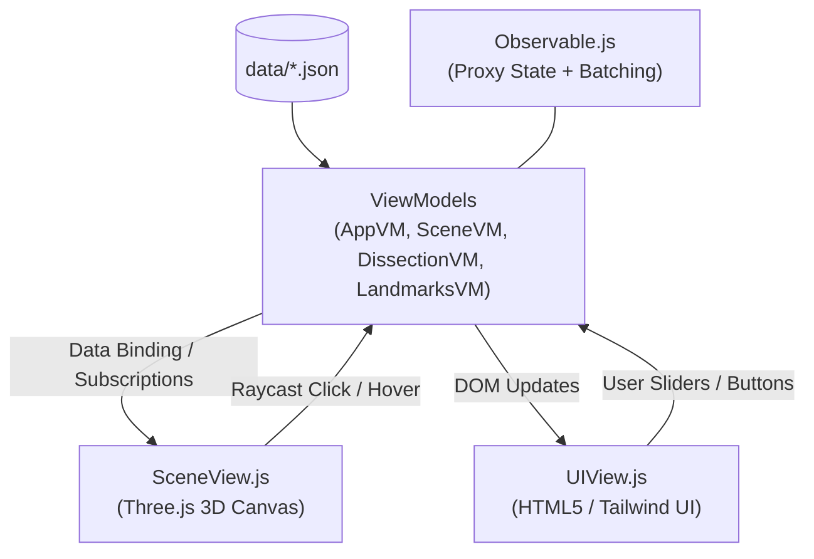

# 🏛️ Digestive 3D Module Architecture: Engineering & Structural Guide

Hướng dẫn chuẩn mực về tổ chức mã nguồn, phân chia ranh giới module, quản lý trạng thái phản ứng MVVM và duy trì hiệu năng 60 FPS cho ứng dụng **Mô Phỏng & Bóc Tách Giải Phẫu Hệ Tiêu Hóa Người 3D (ĐHYHN)**.

---

## 1. Cấu Trúc Thư Mục Dự Án (Project Layout)

```
digestion_system_study/
├── .agents/                                # Antigravity Customizations
│   ├── agents/                             # Specialized Subagents
│   │   ├── hollow-organ-anatomist/         # Chuyên gia mô học tạng rỗng & texture
│   │   ├── digestive-module-architect/     # Chuyên gia kiến trúc module & MVVM
│   │   └── clinical-anatomy-qa/            # Chuyên gia thẩm định giải phẫu & CDP test
│   └── skills/                             # Reusable Skill Runbooks
│       ├── hollow-organ-layer-synthesizer/ # Bóc tách tầng mô học & PBR textures
│       ├── digestive-module-architecture/  # Cẩm nang kiến trúc module (tài liệu này)
│       └── clinical-landmarks-and-heatmaps/# Heatmap bậc rời rạc & điểm mốc lâm sàng
├── assets/
│   ├── css/theme.css                       # Giao diện y khoa tối giản, Dark Mode
│   ├── models/                             # File nhị phân 3D đã tối ưu hóa (.glb)
│   │   ├── DigestiveSystem.glb             # Toàn bộ hệ thống tiêu hóa gốc
│   │   ├── UpperDigestiveTract.glb         # Khối tiêu hóa trên & dạ dày đa lớp
│   │   ├── HepaticVessels.glb              # Cây mạch máu gan/cửa đã uốn nắn
│   │   └── TorsoAbdominalWall.glb          # Thành bụng & khung xương sườn
├── data/                                   # Data Contracts (Hợp đồng dữ liệu JSON)
│   ├── organs.json                         # 17 cơ quan, tầng giải phẫu, mạch máu, thần kinh
│   ├── layers_config.json                  # Cấu hình chiều dày & đặc tính 5 tầng mô học
│   └── clinical_landmarks.json             # Danh mục điểm mốc lâm sàng/ngoại khoa
├── viewmodels/                             # Tầng MVVM ViewModels (Logic trạng thái)
│   ├── Observable.js                       # Micro reactive framework (Proxy + Pub/Sub + Batch)
│   ├── AppViewModel.js                     # Trạng thái toàn cục (Mode 1 / Mode 2, Drawer)
│   ├── SceneViewModel.js                   # Lựa chọn tạng, camera focus, hover state
│   ├── DissectionViewModel.js              # Trượt bóc tách, cô lập, cắt 50%, heatmap/layers
│   └── LandmarksViewModel.js               # Điểm mốc đang chọn, camera hội tụ
├── views/                                  # Tầng Views (Giao diện DOM & Canvas Three.js)
│   ├── SceneView.js                        # Điều phối Three.js canvas, raycast, render loop
│   ├── UIView.js                           # Điều khiển UI tối giản, SVG Clinical Body Map
│   └── modules/                            # 3D Submodules (Phân rã trách nhiệm duy nhất)
│       ├── StomachLayersBuilder.js         # Vertex Inset, Local UVs, Landmark Splines
│       ├── ExplosionManager.js             # Động học bóc tách chiều sâu Z zero-overlap
│       ├── ProceduralTextures.js           # Sinh texture Canvas PBR thớ cơ & nếp gấp
│       └── HoverCalloutView.js             # Thẻ chú giải 2D + leader line SVG chống tràn
├── scripts/                                # Python Automation & Build Pipelines
│   ├── build_upper_digestive_glb.py        # Tách & tối ưu UpperDigestiveTract.glb
│   ├── build_hepatic_vessels_glb.py        # Tinh chỉnh tọa độ mạch máu tránh đâm xuyên
│   └── verify_*.py                         # Headless Edge CDP Automated Verification scripts
├── app.js                                  # Entrypoint khởi tạo & dependency injection
└── index.html                              # Shell HTML5 nạp module ES6
```

---

## 2. Kiến Trúc MVVM Phản Ứng (Reactive MVVM Pattern)

Ứng dụng sử dụng mô hình **Model - View - ViewModel (MVVM)** thuần ES6 không phụ thuộc framework cồng kềnh (React/Vue), đạt độ phản hồi mili-giây và khả năng kiểm thử độc lập cao.



### Nguyên Tắc Hoạt Động Của `Observable.js`:
1. **Proxy State Trap**: Mọi thao tác gán `vm.state.key = value` tự động kích hoạt thông báo cho các hàm đăng ký `vm.subscribe('key', callback)`.
2. **Cơ Chế Gom Nhóm `batch(() => { ... })`**: Khi cập nhật nhiều thuộc tính cùng lúc (ví dụ: chuyển tạng + bật cô lập + đặt lại góc xoay camera), các subscriber chỉ được gọi 1 lần duy nhất sau khi batch hoàn tất, tránh rung lắc màn hình và sụt giảm FPS.

---

## 3. Phân Rã & Module Hóa Tầng View 3D (`views/modules/`)

Để tránh file `SceneView.js` biến thành file monolithic quá tải (>3000 dòng), các phân hệ kỹ thuật 3D phức tạp bắt buộc phải được tách vào thư mục [`views/modules/`](file:///d:/huong/antigravity/digestion_system_study/views/modules/):

### 1. `StomachLayersBuilder.js`:
- Chuyên trách tạo hình học $N$ lớp mô học đồng tâm từ mesh gốc qua thuật toán Vertex Normal Inset.
- Tính toán Local Anatomical UVs độc lập với atlas UV toàn cục.
- Nội suy đường cắt mượt mà bằng Catmull-Rom spline dựa trên các điểm mốc giải phẫu thực tế.

### 2. `ExplosionManager.js`:
- Quản lý trạng thái và động học bóc tách theo trục chiều sâu vuông góc màn hình ($Z$-axis Near-to-Far).
- Kiểm soát ma trận dịch chuyển zero-overlap giữa các lớp vỏ.
- Điều khiển mặt phẳng cắt clipping planes: mở unclipped cho lớp ngoài khi bóc tách, giữ nguyên mặt cắt lòng tạng cho lớp niêm mạc trong cùng.

### 3. `ProceduralTextures.js`:
- Khởi tạo Canvas 2D trong bộ nhớ (`document.createElement('canvas')`).
- Thuật toán fractal vẽ mạng lưới vi mạch dưới niêm mạc.
- Thuật toán sóng sin kép tạo nếp gấp nhăn nheo Rugae lòng dạ dày và van Kerckring tá tràng.
- Cung cấp PBR Maps (diffuse, bumpMap, roughnessMap).

### 4. `HoverCalloutView.js`:
- Quản lý phần tử DOM nổi chứa SVG leader line và anchor dot.
- Thuật toán tính góc gập khuỷu (elbow direction) và tính tọa độ thẻ gọi:
  - Tự động tránh va chạm cạnh màn hình (Viewport Collision Avoidance).
  - Tự động tránh va chạm với ngăn kéo thông tin bên phải (`#organ-drawer`).

---

## 4. Pipeline Xử Lý Tài Nguyên 3D Bằng Python (`scripts/`)

Mọi mô hình 3D đều được tiền xử lý và tinh chỉnh chính xác bằng các script Python chuyên dụng:

### Quy Trình Xử Lý Mạch Máu Tránh Xuyên Tạng (`build_hepatic_vessels_glb.py`):
1. **Cắt Gọt Động Mạch Gan Riêng**: Cắt tỉa các nhánh spline $X < -9.35$ để đầu mạch đỏ không bị nhô ra ngoài bao gan.
2. **Uốn Lại Tĩnh Mạch Vị Mạc Nối**: Reroute toàn bộ đường cong spline của `CULeft gastro-omental vein` và `CURight gastro-omental vein` chạy dọc theo bờ cong lớn nằm lọt trong dây chằng dạ dày - đại tràng ($Y \le 110.05$). Thuật toán kiểm tra 316 điểm lấy mẫu đảm bảo **0 điểm đâm xuyên lòng dạ dày**.
3. **Hạ Thấp Điểm Đổ Tĩnh Mạch Chủ Dưới (IVC)**: Hạ điểm tiếp nối xuống $Y \le 122.8$, bảo đảm tĩnh mạch xanh không bị chọc thủng vòm hoành gan ($Y_{\text{max}} = 124.08$).

---

## 5. Shader Discard & Clipping System

Khi người dùng mở chế độ **Mặt Cắt Dọc 50% (`isCutawayOpen = true`)**, hệ thống phối hợp 2 cơ chế cắt lớp:
1. **Three.js Clipping Plane**:
   ```javascript
   const cutPlane = new THREE.Plane(new THREE.Vector3(cutSide, 0, 0), 0.0);
   material.clippingPlanes = isCutaway ? [cutPlane] : [];
   ```
2. **Coronal Cutaway Discard Shader Cho Mạch Máu**:
   Mạch máu bao quanh dạ dày được gắn shader inject qua `onBeforeCompile`:
   ```glsl
   // Loại bỏ các đoạn mạch nằm trong hộp giới hạn cắt lòng dạ dày
   if (uVesselCutActive > 0.5) {
     if (vWorldPos.z > 7.2 && vWorldPos.x > -2.5 && vWorldPos.x < 7.5 &&
         vWorldPos.y > 109.5 && vWorldPos.y < 122.5) {
       discard;
     }
   }
   ```
   Giúp lòng dạ dày khi mở mặt cắt hiển thị hoàn toàn sạch sẽ, thoáng đãng, học viên nhìn rõ lớp niêm mạc Rugae bên trong mà không bị mạch máu đâm chéo qua.

---

## 6. Hợp Đồng Dữ Liệu (Data Contracts Integrity)

Mọi thay đổi dữ liệu phải tuân thủ nghiêm ngặt schema trong `data/*.json`:
- `data/organs.json`: Mỗi tạng phải có đủ `id`, `name`, `latinName`, `systemTier`, `bloodSupply` (artery, vein), `innervation`, và `clinicalNotes`.
- `data/layers_config.json`: Định nghĩa thứ tự tầng mô học từ ngoài vào trong (`order: 1..5`), độ dày danh định (`thickness_mm`), tế bào học (`histology`), và chức năng sinh lý (`physiology`).
- `data/clinical_landmarks.json`: Tọa độ 3D chuẩn xác (`coordinates: [x, y, z]`), góc nhìn camera tối ưu (`cameraFocus: [x, y, z]`), ý nghĩa ngoại khoa và nghiệm pháp lâm sàng.

---

## 7. Checklist Kiểm Tra Khi Thêm Hoặc Sửa Đổi Module

- [ ] Đã tách logic tính toán nặng ra khỏi render loop?
- [ ] Không có vòng lặp phụ thuộc (circular dependency) giữa ViewModels và Views?
- [ ] Các đỉnh BufferAttribute có kiểm tra `needsUpdate = true` sau khi biến đổi?
- [ ] Màu sắc trên bề mặt 3D khớp 100% với chấm màu trên thẻ Hover Callout?
- [ ] Đã chạy kịch bản kiểm thử tự động headless CDP để xác nhận 60 FPS và không có console error?
- [ ] **Tuân thủ cam kết: Tuyệt đối không tự động chạy `git push` lên GitHub remote.**
