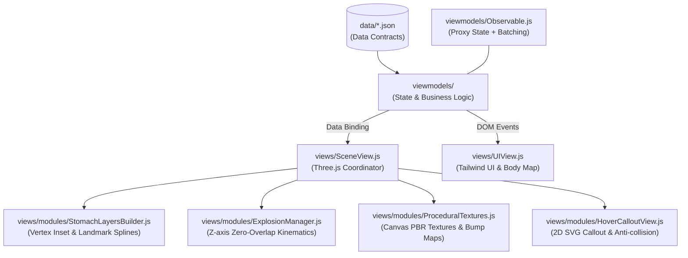

# 🩺 Hướng Dẫn & Quy Chuẩn Kiến Trúc Cho AI Agents (AGENTS.md)

Chào mừng bạn đến với dự án **Ứng Dụng Mô Phỏng & Bóc Tách Giải Phẫu Hệ Tiêu Hóa 3D (ĐHYHN)**.  
Tài liệu này là quy chuẩn kỹ thuật bắt buộc cho toàn bộ các AI Agents và subagents khi tham gia phát triển, sửa lỗi hoặc tái cấu trúc mã nguồn trong kho lưu trữ này.

---

## 1. Bản Sắc Dự Án & Chuẩn Mực Y Khoa

- **Mục tiêu**: Nền tảng học tập giải phẫu, mô học và định vị điểm mốc lâm sàng hệ tiêu hóa người dạng 3D tương tác thời gian thực trên nền WebGL/Three.js.
- **Tiêu chuẩn học thuật**: Tuân thủ nghiêm ngặt giáo trình Đại học Y Hà Nội (ĐHYHN) và danh pháp quốc tế Terminologia Anatomica (TA2).
- **Ngôn ngữ hiển thị**: Tiếng Việt học thuật chuẩn xác, kèm danh pháp Latin chính thống (ví dụ: *Đại tràng xuống / Colon Descendens*, *Thân vị / Corpus Gastricum*, *Hành tá tràng / Bulbus Duodeni*).

---

## 2. Các Quy Tắc Bất Di Bất Dịch (Inviolable Rules)

> [!CAUTION]
> ### 1. Kỷ Luật Git: Tuyệt Đối KHÔNG Tự Động Push
> **NGHIÊM CẤM thực hiện lệnh `git push` lên GitHub remote khi chưa có yêu cầu trực tiếp bằng văn bản từ người dùng.**  
> Mọi thay đổi mã nguồn chỉ được commit cục bộ (`git commit`) trên máy để người dùng kiểm tra và phê duyệt.

> [!IMPORTANT]
> ### 2. Nhãn Giao Diện Tối Giản
> Giữ các nhãn và tiêu đề tối giản, thanh lịch, trang nhã.  
> **Loại bỏ toàn bộ các emoji thừa thãi và các phần chú giải dài dòng trong dấu ngoặc đơn `(...)`**.

> [!IMPORTANT]
> ### 3. Chế Độ Sơ Đồ Cơ Thể Duy Nhất
> Trong chế độ cô lập, **đã loại bỏ hoàn toàn chế độ "Danh sách"**.  
> Chỉ sử dụng **Sơ đồ phân chia cơ thể SVG (Clinical Body Map)** trực quan để chuyển đổi nhanh giữa các tạng.

> [!IMPORTANT]
> ### 4. Heatmap Phân Vùng Bậc Rời Rạc (Solid Step Color)
> Mỗi phân đoạn giải phẫu (ví dụ: Đại tràng xuống) **bắt buộc phải được tô DUY NHẤT 1 MÀU ĐƠN SẮC** từ dải màu pastel, biên giới sắc nét.  
> Tuyệt đối không dùng gradient biến thiên liên tục làm lem 2 màu trên cùng một phân đoạn. Màu sắc bề mặt 3D phải trùng khớp 100% với chấm màu trên thẻ Hover Card.

---

## 3. Kiến Trúc Mã Nguồn & Bản Đồ Module

Dự án áp dụng mô hình **MVVM Phản Ứng (Reactive MVVM)** thuần ES6 kết hợp phân rã Three.js View:

### Quy định trách nhiệm từng module:
- `Observable.js`: Quản lý phản ứng Proxy State. Mọi chuỗi thay đổi nhiều thuộc tính phải bọc trong `batch(() => { ... })`.
- `SceneView.js`: Đóng vai trò Coordinator điều phối scene 3D, raycasting và render loop; **không nhồi nhét logic toán học dựng hình vào file này**.
- `views/modules/*`: Chứa các phân hệ kỹ thuật độc lập:
  - `StomachLayersBuilder.js`: Co rút pháp tuyến đỉnh tạo $N$ lớp đồng tâm, nội suy đường cắt mượt theo landmark.
  - `ExplosionManager.js`: Bóc tách chiều sâu $Z$ chống chồng đè, điều khiển mặt phẳng clipping planes.
  - `ProceduralTextures.js`: Sinh texture thớ cơ, mạng mạch máu dưới niêm mạc, nếp gấp Rugae/Villi.
  - `HoverCalloutView.js`: Hiển thị thẻ chú giải nổi chống tràn viewport và chống va chạm drawer.
- `scripts/build_*.py`: Tiền xử lý mô hình 3D bằng Python (Trimesh, pygltflib) uốn nắn mạch máu tránh đâm xuyên lòng dạ dày và vỏ gan.

---

## 4. Hệ Thống Subagents Trong Workspace (`.agents/agents/`)

Khi cần ủy quyền hoặc giải quyết tác vụ chuyên sâu, hãy sử dụng các subagents chuyên biệt đã cấu hình:

| Subagent | Đường Dẫn Định Nghĩa | Chuyên Môn & Khi Nào Nên Kích Hoạt |
| :--- | :--- | :--- |
| **`hollow-organ-anatomist`** | [agent.md](file:///d:/huong/antigravity/digestion_system_study/.agents/agents/hollow-organ-anatomist/agent.md) | Chuyên gia bóc tách mô học tạng rỗng (Dạ dày, Thực quản, Ruột non, Đại tràng), sinh texture Canvas PBR, tính toán UV giải phẫu, tạo mặt cắt mượt theo landmark và cấu hình động học bóc tách chiều sâu. |
| **`digestive-module-architect`** | [agent.md](file:///d:/huong/antigravity/digestion_system_study/.agents/agents/digestive-module-architect/agent.md) | Chuyên gia kiến trúc hệ thống, tái cấu trúc mã nguồn MVVM, phân rã View 3D, điều phối shader discard lòng mạch, chuẩn hóa pipeline GLTF/GLB và duy trì hợp đồng dữ liệu JSON. |
| **`clinical-anatomy-qa`** | [agent.md](file:///d:/huong/antigravity/digestion_system_study/.agents/agents/clinical-anatomy-qa/agent.md) | Chuyên gia kiểm thử tự động headless Edge/Chrome CDP, thẩm định tính chuẩn xác y khoa ĐHYHN, rà soát xung đột mạch máu, kiểm tra màu sắc Heatmap và nghiệm thu chất lượng hiển thị. |

---

## 5. Hệ Thống Skills Trong Workspace (`.agents/skills/`)

Các tài liệu hướng dẫn kỹ thuật chi tiết theo từng chủ đề:

| Skill | Đường Dẫn Hướng Dẫn | Nội Dung Trọng Tâm |
| :--- | :--- | :--- |
| **`hollow-organ-layer-synthesizer`** | [SKILL.md](file:///d:/huong/antigravity/digestion_system_study/.agents/skills/hollow-organ-layer-synthesizer/SKILL.md) | Công thức toán học co rút đỉnh (Vertex Inset), thuật toán vẽ thớ cơ/rugae bằng Canvas 2D, vector bóc tách $Z$ zero-overlap và mặt phẳng cắt thông minh. |
| **`digestive-module-architecture`** | [SKILL.md](file:///d:/huong/antigravity/digestion_system_study/.agents/skills/digestive-module-architecture/SKILL.md) | Cẩm nang kiến trúc phần mềm, nguyên tắc phân rã `views/modules/`, cơ chế reactive MVVM, shader discard mạch máu trong dạ dày, pipeline Python 3D GLB. |
| **`clinical-landmarks-and-heatmaps`** | [SKILL.md](file:///d:/huong/antigravity/digestion_system_study/.agents/skills/clinical-landmarks-and-heatmaps/SKILL.md) | Ma trận Heatmap bậc rời rạc 9 hệ tạng, thuật toán mặt cắt mượt Catmull-Rom spline, sơ đồ cơ thể SVG tối giản và SOP kiểm thử tự động headless CDP. |
