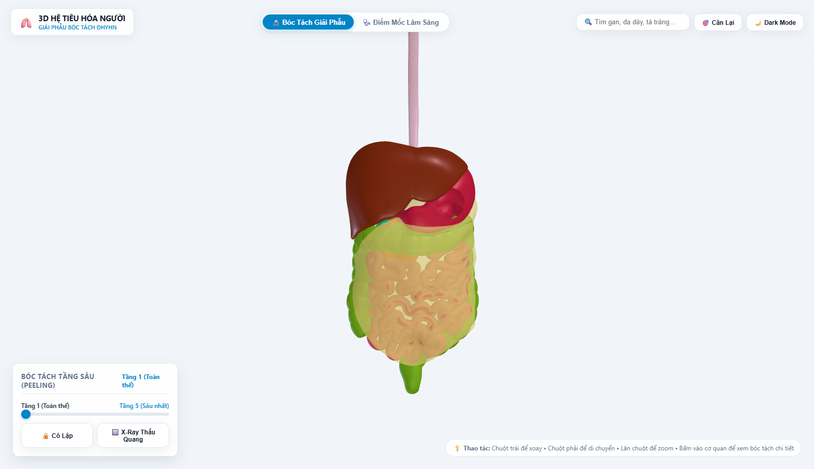
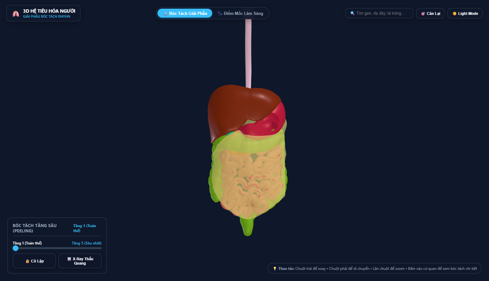
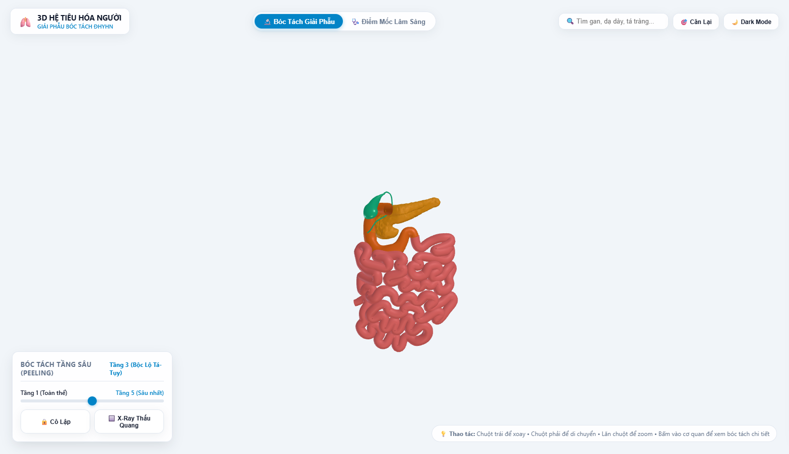
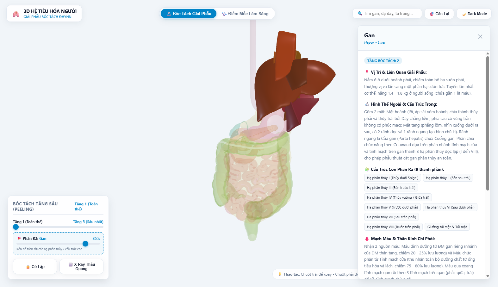
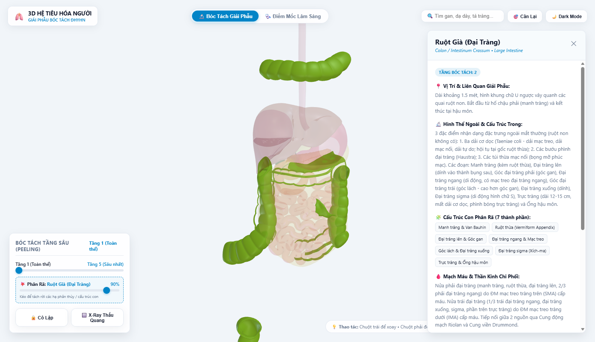
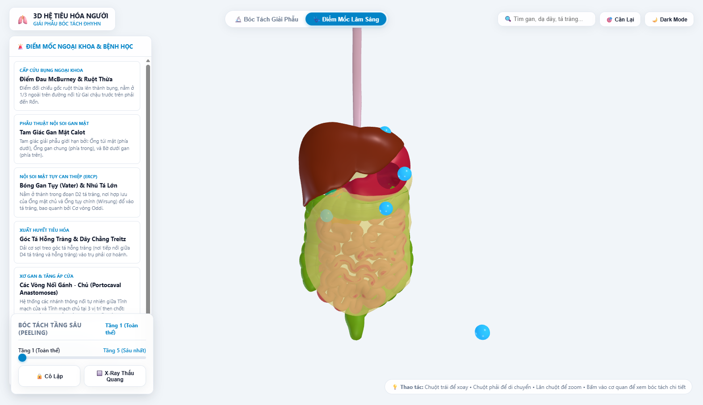

# Ứng Dụng 3D Giải Phẫu & Bóc Tách Hệ Tiêu Hóa Người
### 3D Human Digestive Anatomy & Surgical Dissection Suite
> **Mô hình y khoa chuẩn Z-Anatomy (BodyParts3D) & Giáo trình Giải Phẫu Người — Đại Học Y Hà Nội**

[](https://hmh-215.github.io/human-digestive-anatomy-3d/)
[](https://creativecommons.org/licenses/by-sa/4.0/)
[](https://threejs.org/)

---

## 🌐 Trải Nghiệm Bản Demo Trực Tuyến

👉 **Truy cập ngay bản demo trên GitHub Pages:**  
**[https://hmh-215.github.io/human-digestive-anatomy-3d/](https://hmh-215.github.io/human-digestive-anatomy-3d/)**

*(Hỗ trợ mọi trình duyệt hiện đại Chrome, Edge, Safari, Firefox trên cả PC, Tablet và Mobile mà không cần cài đặt).*

---

## 📸 Hình Ảnh Giao Diện & Tính Năng

| Toàn Thể Hệ Tiêu Hóa (Z-Anatomy) | Chế Độ Dark Mode Ban Đêm |
| :---: | :---: |
|  |  |

| Bóc Tách Tầng 3 (Khối Tá-Tụy & Ống Mật) | Phân Rã 8 Hạ Phân Thùy Couinaud (I - VIII) |
| :---: | :---: |
|  |  |

| Phân Rã Khung Đại Tràng & Ruột Thừa | Điểm Mốc Ngoại Khoa & Bệnh Học |
| :---: | :---: |
|  |  |

---

## 🌟 TÍNH NĂNG NỔI BẬT

1. **Mô Hình 3D Y Khoa Thật Chuẩn Z-Anatomy**:
   - Tích hợp trực tiếp từ tập dữ liệu giải phẫu bản quyền mở *Z-Anatomy (BodyParts3D - University of Tokyo)*.
   - Chi tiết đến từng nếp niêm mạc, rãnh mạch, túi thừa, ống tụy chính Wirsung, ống mật chủ, túi mật và ruột thừa.

2. **Bóc Tách Phân Tầng Phẫu Tích (5-Level Surgical Peeling)**:
   - **Tầng 1 (Toàn thể)**: Hệ tiêu hóa nguyên vẹn với mạc nối lớn che phủ phía trước.
   - **Tầng 2 (Bóc mạc nối)**: Tháo bỏ mạc nối lớn để quan sát toàn bộ quai ruột và khung đại tràng.
   - **Tầng 3 (Bộc lộ Tá - Tụy)**: Bóc tách thành trước dạ dày và gan, bộc lộ trọn vẹn khối chữ C Tá tràng ôm đầu Tụy, ống tụy chính Wirsung và ống mật chủ.
   - **Tầng 4 & 5 (Sâu nhất)**: Đi sâu vào cuống mạch mạc treo và tạng sau phúc mạc.

3. **Phân Rã Cụm Cục Bộ (Localized Sub-Assembly Explosion)**:
   - **Gan**: Tách rời 8 hạ phân thùy Couinaud (từ I đến VIII) theo các vector hướng tâm ngoại khoa.
   - **Ruột già**: Đẩy đại tràng ngang lên trên, bộc lộ góc hồi manh tràng và tách rời ruột thừa (*Vermiform Appendix*) cùng mạc treo.
   - **Khối tá - tụy**: Tách túi mật và ống tụy chính khỏi nhu mô tá tràng.

4. **Smart Contextual Ghosting (Bóng Ma X-Ray Thông Minh)**:
   - Click chọn 1 cơ quan $\rightarrow$ các cơ quan che khuất xung quanh tự động mờ thấu quang 12% (X-ray ghosting) để vừa soi rõ tạng cần học, vừa giữ nguyên định hướng không gian lân cận.
   - Nút **Cô Lập (Isolate)**: Tách riêng cơ quan được chọn ra không gian trống 360 độ.

5. **Điểm Mốc Bệnh Học & Ngoại Khoa Lâm Sàng**:
   - 6 mốc phẫu thuật kinh điển: *Điểm McBurney (ruột thừa), Tam giác túi mật Calot, Bóng Vater & Cơ vòng Oddi, Dây chằng Treitz, 8 Hạ phân thùy Couinaud, Vòng nối Gánh - Chủ*.
   - Đánh dấu 3D phát sáng nhấp nháy trên mô hình.

6. **Dữ Liệu Y Khoa Chuẩn ĐHYHN**:
   - 100% tiếng Việt y khoa chuẩn từ *Giáo trình Giải Phẫu Người — PGS. TS. Nguyễn Văn Huy (Đại Học Y Hà Nội)*.
   - Song hành danh pháp Latin quốc tế và Terminologia Anatomica 2 (TA2).

---

## 🏛️ KIẾN TRÚC HỆ THỐNG (REACTIVE MVVM)

```
[ Model: organs.json & clinical_landmarks.json ]
       │
       ▼
[ ViewModels: AppVM ── DissectionVM ── SceneVM ── LandmarksVM ]
       │                      │
       ▼                      ▼
[ SceneView (WebGL Three.js) ]   [ UIView (DOM UI Controller) ]
```

- **Model Layer**: `data/organs.json`, `data/clinical_landmarks.json`, `data/layers_config.json`.
- **ViewModel Layer**: `Observable.js` (Proxy state manager với batch update), `AppViewModel`, `SceneViewModel`, `DissectionViewModel`, `LandmarksViewModel`.
- **View Layer**: `SceneView.js` (Three.js WebGL Renderer, OrbitControls, PBR Shaders, Raycaster), `UIView.js` (DOM Controller, Glassmorphism HUD).

---

## 💻 CHẠY TRÊN MÁY CỤC BỘ (LOCAL HOST)

Nếu muốn chạy trên máy cá nhân để phát triển thêm:

1. **Khởi chạy bằng PowerShell (Port 8085)**:
   ```powershell
   powershell -ExecutionPolicy Bypass -File .\server.ps1
   ```
2. **Khởi chạy bằng Python**:
   ```bash
   python -m http.server 8085
   ```
3. Mở trình duyệt tại: `http://localhost:8085/`

---

## 📄 BẢN QUYỀN & NGUỒN TÀI NGUYÊN

- **3D Mesh Data**: [Z-Anatomy](https://github.com/Z-Anatomy/Models-of-human-anatomy) & [BodyParts3D](https://lifesciencedb.jp/bp3d/) (Creative Commons BY-SA 4.0).
- **Y Khoa & Danh Pháp**: Bộ môn Giải Phẫu — Trường Đại Học Y Hà Nội.
